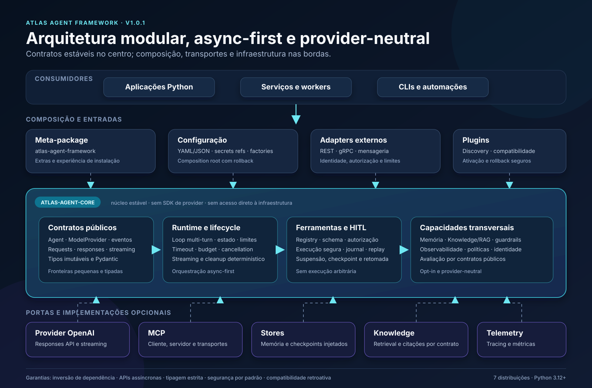
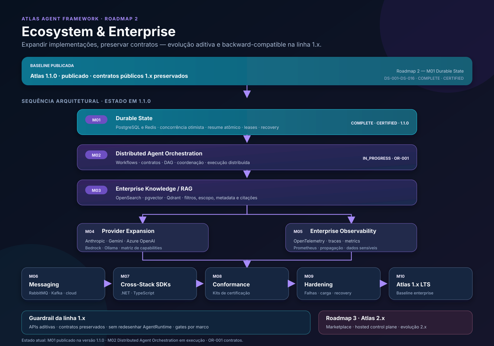

# Arquitetura implementada — Atlas Agent Framework 1.1.0



O diagrama acima registra a fundação arquitetural consolidada na linha 1.x. A
evolução do Roadmap 2 e seu estado atual estão representados no diagrama ao
final deste documento.

## Como ler a arquitetura

O pacote `atlas-agent-core` define contratos estáveis e concentra a
orquestração provider-neutral. As dependências apontam das integrações para o
core: o núcleo não conhece OpenAI, FastAPI, gRPC, brokers, PostgreSQL, Redis,
bancos vetoriais ou ferramentas concretas de telemetria.

Aplicações chegam ao framework por APIs Python, configuração declarativa,
adapters ou plugins. `AgentRuntime` coordena lifecycle, streaming e ciclos
multi-turn. Ferramentas, HITL, memória, Knowledge/RAG, guardrails e
observabilidade são integrados por contratos explícitos e injeção de
dependências. Providers, transportes e infraestrutura permanecem substituíveis
nas bordas.

## Distribuições publicadas

| Distribuição | Responsabilidade arquitetural |
| --- | --- |
| `atlas-agent-core` | Contratos, runtime e capacidades provider-neutral |
| `atlas-agent-providers` | Providers oficiais, começando pela OpenAI |
| `atlas-agent-mcp` | Cliente e servidor Model Context Protocol |
| `atlas-agent-adapters` | REST, gRPC, mensageria e persistência PostgreSQL/Redis |
| `atlas-agent-config` | Configuração declarativa e composition root |
| `atlas-agent-evaluation` | Datasets, evaluators, scoring e relatórios |
| `atlas-agent-framework` | Meta-package e experiência de instalação |

As sete distribuições da versão `1.1.0` estão publicadas no PyPI por Trusted
Publishing.

## Decisões estruturantes

- infraestrutura implementa contratos definidos pelo core;
- operações de I/O são assíncronas e propagam cancellation;
- modelos de fronteira são tipados, validados e preferencialmente imutáveis;
- ferramentas são conhecidas, autorizadas e validadas antes da execução;
- memória e retrieval são tratados como dados não confiáveis;
- plugins e integrações são opcionais, sem service locator no core;
- observabilidade é injetada e fail-open, com defaults no-op;
- segredos e acesso à rede não pertencem ao core;
- evolução da linha 1.x é aditiva e backward-compatible.

## Fluxo de execução

```text
Aplicação
   ↓
Composição / adapter / plugin
   ↓
AgentRuntime
   ├── lifecycle, estado, limites e policies
   ├── ModelProvider → resposta ou tool call
   ├── ToolExecutor → autorização, validação e execução
   ├── HITL → suspensão, checkpoint e retomada
   └── memória, Knowledge/RAG, guardrails e observabilidade
            ↓
     implementações opcionais nas bordas
```

## M01 — Durable State

O M01 foi concluído pelas tarefas DS-001–DS-016, certificado e publicado na
versão `1.1.0`. O contrato mínimo `CheckpointStore` foi preservado; garantias
adicionais são expostas por capabilities opcionais.

| Grupo | Entrega certificada |
| --- | --- |
| DS-001–DS-004 | contrato, PostgreSQL, concorrência otimista e consumo atômico |
| DS-005–DS-009 | leases, fencing, recovery, retenção, purge e migrations |
| DS-010–DS-011 | Redis, atomicidade por Lua e consistência distribuída |
| DS-012–DS-014 | crash recovery, Kubernetes e HITL durável |
| DS-015–DS-016 | desempenho, carga, auditoria final e certificação do M01 |

A implementação PostgreSQL usa transações, migrations versionadas e o relógio
do banco como autoridade temporal. A implementação Redis usa Lua, CAS, leases,
fencing e TTL; suas garantias de durabilidade dependem da persistência e da
topologia configuradas. O recovery coordinator revalida elegibilidade sob
ownership antes de retomar uma execução.

A propriedade protegida é:

```text
one approval → one resume → one side effect
```

Ela representa autorização de retomada no máximo uma vez. Não declara
exactly-once para efeitos externos; aplicações continuam responsáveis por
idempotência e reconciliação desses efeitos.

## Roadmap 2 — Ecosystem & Enterprise



O Roadmap 2 preserva `AgentRuntime` e os contratos públicos como baseline. O
estado formal atual é:

| Marco | Escopo | Estado |
| --- | --- | --- |
| M01 | Durable State | `COMPLETE` · `CERTIFIED` · publicado em `1.1.0` |
| M02 | Distributed Agent Orchestration & Execution | em execução · OR-001 implementada |
| M03 | Enterprise Knowledge / RAG | planejado |
| M04 | Provider Expansion | planejado |
| M05 | Enterprise Observability | planejado |
| M06 | Messaging & Integration | planejado |
| M07 | Cross-Stack SDKs | planejado |
| M08 | Conformance & Certification | planejado |
| M09 | Production Hardening | planejado |
| M10 | Atlas 1.x LTS | planejado |

A conclusão de um marco não inicia automaticamente o seguinte. Cada marco exige
escopo próprio, gates técnicos, evidências e decisão formal.

Consulte o [índice do Roadmap 2](../roadmap-2/README.md), o
[fechamento do M01](../roadmap-2/m01-durable-state/README.md) e as
[notas da versão 1.1.0](../release/releases/1.1.0.md).

O M02 inicia a evolução multiagente por contratos aditivos. A OR-001 define
workflows declarativos, contexto, lifecycle, resultados, eventos, policies e a
fronteira assíncrona `WorkflowOrchestrator`; não contém engine, scheduler ou
workers. Marketplace e control plane hospedado permanecem fora deste ciclo.
