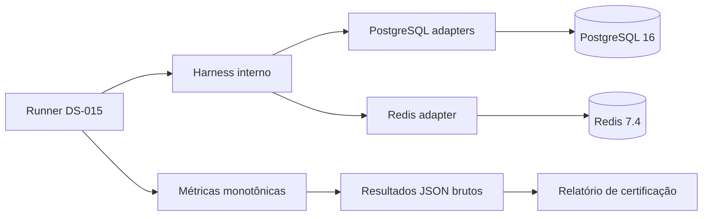

# Arquitetura da certificação de performance

A DS-015 mantém o código de benchmark fora do core e utiliza exclusivamente os
contratos e capabilities públicas já certificados. O runner reside no host
técnico `examples/kubernetes-recovery` e recebe conexões injetadas para
PostgreSQL ou Redis.

O harness é uma fronteira exclusiva da certificação. Ele não é exportado pelo
Atlas, não altera `CheckpointStore` e normaliza apenas a chamada das
capabilities distintas de lease de cada adapter. PostgreSQL e Redis continuam
com suas garantias próprias; os números não são interpretados como equivalência
de durabilidade física.

O processo usa dados sintéticos, banco com sufixo `_test`, namespace Redis
exclusivo e confirmação explícita do ambiente. Nenhuma credencial, prompt ou
dado pessoal é incorporado aos resultados.

## Componentes reutilizados

- `PostgreSQLCheckpointStore` e `RedisCheckpointStore`;
- `PostgreSQLCheckpointLeaseManager` e leases Redis;
- migrations versionadas do adapter PostgreSQL;
- fixture pública compatível com o envelope v1;
- benchmarks especializados de recovery, purge, schema, HITL e Kubernetes.

## Limites arquiteturais

- não há alteração no `AgentRuntime`;
- não há nova API pública;
- não há dependência de infraestrutura no core;
- não há alegação de exactly-once para efeitos externos;
- fault injection ocorre apenas nos containers isolados da certificação.
